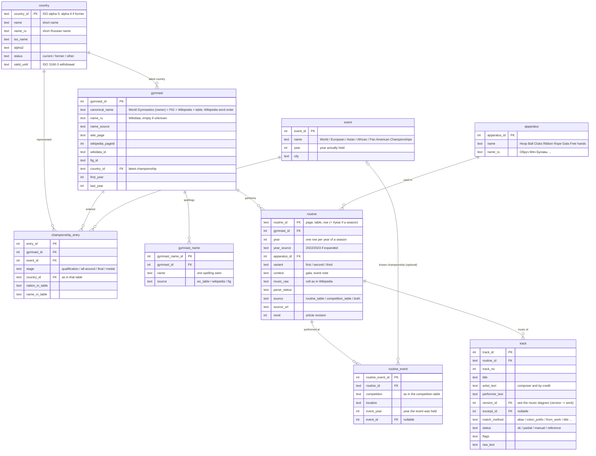
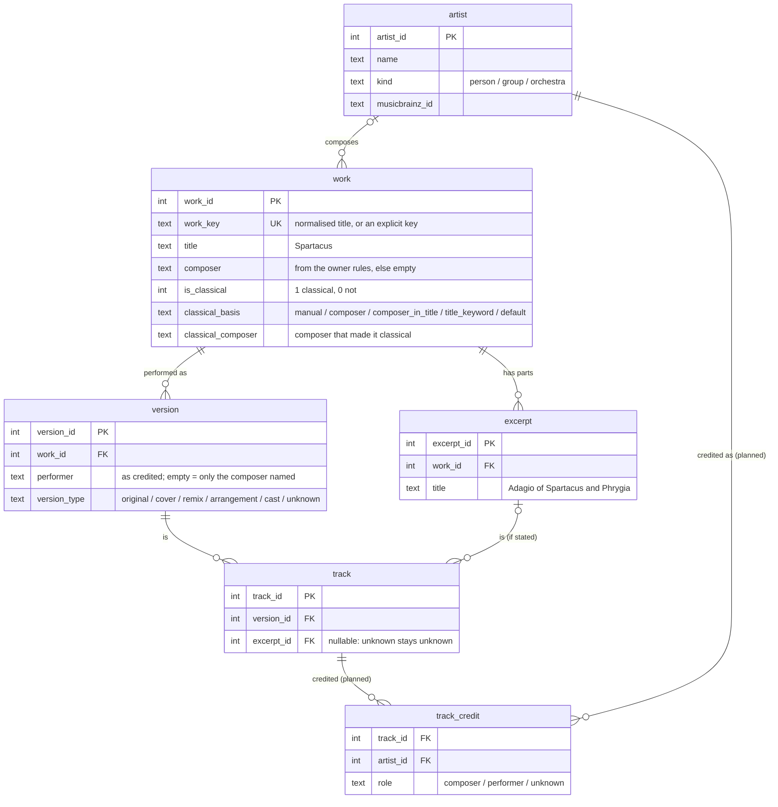

# Planned database schema (SQLite)

Loaded only from the owner-reviewed layer (see CLAUDE.md, "Pipeline layers"). Names are English snake_case; the diagrams
render on GitHub. Counts are from the last run. Russian names (`name_ru`) are empty when unknown; the UI falls back to Latin.

## Core: gymnasts, routines, events (data exists in the CSV files)

## Music: works, excerpts and the classical flag (built; artists planned)

`work`, `version` and `excerpt` come from `works.csv` / `versions.csv` / `track_works.csv` (2 617 works, 2 785 versions).
A version is the work as performed by one performer, exactly as the source credits it (Feeling Good → Muse, Michael
Bublé...); the dashboard opens a work into its versions. `artist` and `track_credit` are planned: today the credit stays
text in `track.artist_text`. Planned `work` fields (owner, 2026-10-07): `name_en/name_ru`, `author_en/author_ru`,
`author_type` (composer / performer / folk / unknown), `from_title` + `from_type` (film / musical / series / game).

## The two questions the schema answers

- gymnast -> music: `gymnast -> routine -> track -> work`, filtered by `routine.year` and `apparatus`.
- music -> gymnasts: `work (excerpt) -> track -> routine -> gymnast`; "classical or not" and its share by year come from
  `work.is_classical` joined to `routine.year`.

Built today by `rg_music/db.py` (simpler than the target above): `gymnast` carries `wc_years` (World Championship
years) and, since step 24, `events` ("world 2019,2021; europe 2020"): every championship of the gymnast, World and
continental (European, Asian, African, Pan American; for most continental championships Wikipedia lists only the
medallists, so only those are known).
