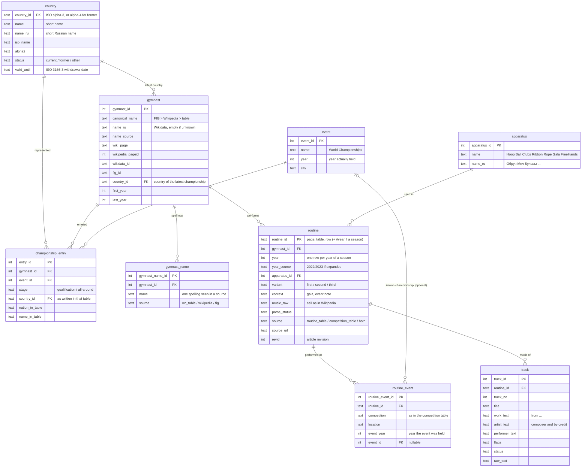
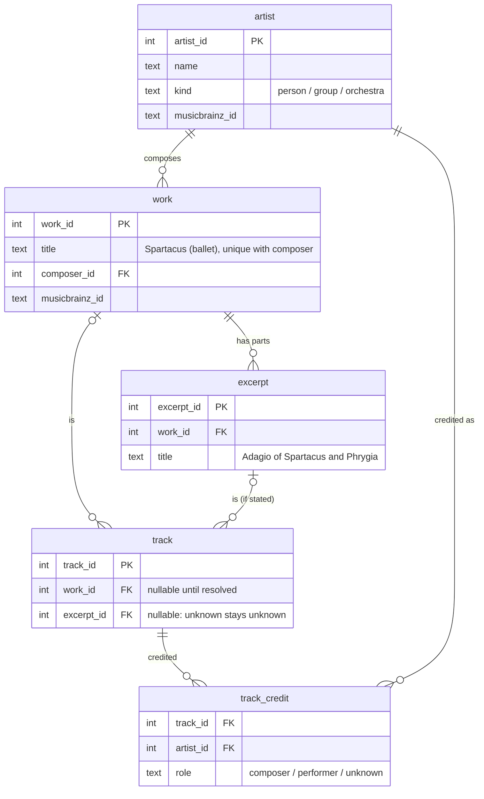

# Planned database schema (SQLite)

Loaded only from the owner-reviewed layer (see CLAUDE.md, "Pipeline layers"). Names are
English snake_case; the diagrams render on GitHub.

## Core: what the current CSV files already contain

## Planned: music entity resolution (work -> excerpt -> recording)

## The two questions the schema answers

- gymnast -> music: `gymnast -> routine -> track`, filtered by `routine.year` and `apparatus`.
- music -> gymnasts: `work/excerpt -> track -> routine -> gymnast` (year, apparatus on the routine).
