# Process: what was done, in which order, and by which scripts

The diagram is the project as it actually went: a first run on 10 gymnasts, then the gymnast list, then the full run, then music matching.
Solid = done; dashed = optional or not used; grey = planned; brown = decided by the owner; yellow diamonds = forks.

```mermaid
flowchart TD
  WP[("Википедия<br/>MediaWiki API")]:::src
  SEED0["seed_gymnasts.txt<br/>10 гимнасток"]:::data

  subgraph F1["Фаза 1 · Первый заход: 10 гимнасток"]
    S1["<b>1 · Выгрузка таблиц с музыкой</b><br/>extract.py<br/>wiki_client.py · tables.py · events.py"]:::step
    RAW[("routines_raw.csv<br/>competitions_raw.csv")]:::data
    QA["Сверка двух таблиц<br/>crosscheck.py"]:::optional
    S2["<b>2 · Разбор ячейки музыки и предметов</b><br/>parse.py · music_parser.py<br/>apparatus.py · years.py"]:::step
    T1[("tracks.csv<br/>routines_parsed.csv")]:::data
  end

  subgraph F2["Фаза 2 · Список гимнасток из чемпионатов мира"]
    S3["<b>3 · Гимнастки из таблиц 42 чемпионатов</b><br/>worlds.py"]:::step
    CNT["<b>3а · Справочник стран</b> ISO 3166-1 и -3<br/>countries.py"]:::step
    WC[("wc_appearances.csv · wc_gymnasts.csv<br/>wc_name_review.csv")]:::data
    D1{"Спорные написания<br/>имён?"}:::decision
    S4["<b>4 · Имя по FIG</b> (Викиданные и сайт FIG)<br/>fig_names.py"]:::step
    R1{{"Проверка владелицей:<br/>какое имя верное"}}:::owner
    S5["<b>5 · Решения по именам, итоговый список</b><br/>name_decisions.py"]:::step
    S5b["<b>5а · Русские имена</b> (Викиданные)<br/>names_ru.py"]:::step
    FIN[("wc_gymnasts_final.csv<br/>533 статьи · 1 395 человек")]:::data
  end

  subgraph F3["Фаза 3 · Полная выгрузка: 533 гимнастки"]
    S6["<b>6 · Повторная выгрузка</b><br/>extract.py --seed seed_wc_gymnasts.txt"]:::step
    S7["<b>7 · Слияние таблиц, сезоны в годы</b><br/>merge.py"]:::step
    M1[("routines_merged.csv<br/>routine_events.csv")]:::data
    S8["<b>8 · Разбор ячеек (повторно)</b><br/>parse.py"]:::step
    D2{"Правила не могут<br/>разрезать ячейку<br/>(6 шт.)"}:::decision
    MAN{{"Ручной разбор владелицей<br/>data/manual/music_overrides.csv"}}:::owner
    LLM["Разбор моделью<br/>llm_parse.py<br/>(написан, не использован)"]:::optional
    T2[("tracks.csv · routines_parsed.csv<br/>3 964 выступления · 4 077 треков")]:::data
  end

  subgraph F4["Фаза 4 · Сопоставление музыки"]
    S9["<b>9 · Проход 1: группы по названию</b><br/>works.py"]:::step
    S10["<b>10 · Проход 2: фрагменты, опечатки, правила</b><br/>works.py --resolve"]:::step
    R2{{"Решения владелицы: Carmina Burana,<br/>Carmen, балеты<br/>data/manual/work_aliases.csv"}}:::owner
    S11["<b>11 · Классика или нет</b><br/>classical.py<br/>classical_composers.csv"]:::step
    W[("works.csv · track_works.csv<br/>work_merge_review.csv")]:::data
    S12["<b>12 · Композиторы как предложения</b> (MusicBrainz)<br/>composers.py"]:::optional
    SUG[("composer_suggestions.csv<br/>на подтверждение")]:::data
  end

  subgraph F5["Фаза 5 · В плане"]
    RGF["Второй источник<br/>rgforum.no (архив)"]:::planned
    DB["<b>13 · Загрузка в SQLite</b><br/>только проверенные данные"]:::planned
    DASH["<b>14 · Дашборд EN и RU</b><br/>фильтры, плашки, ссылки YouTube"]:::planned
  end

  WP --> S1
  SEED0 --> S1
  S1 --> RAW
  RAW -.-> QA
  RAW --> S2
  S2 --> T1
  T1 -.->|"нужен список гимнасток"| S3

  WP --> S3
  CNT --> S3
  S3 --> WC
  WC --> D1
  D1 -->|"да"| S4
  S4 --> R1
  R1 --> S5
  D1 -->|"нет"| S5
  S5 --> FIN
  S5b --> FIN
  FIN ==>|"wiki_page: seed на 533 статьи"| S6

  WP --> S6
  S6 --> S7
  S7 --> M1
  M1 --> S8
  S8 -->|"остальные ячейки"| T2
  S8 --> D2
  D2 -->|"выбрано"| MAN
  MAN --> T2
  D2 -.->|"альтернатива"| LLM
  LLM -.-> T2

  T2 --> S9
  S9 --> S10
  S10 --> S11
  S11 --> W
  S10 -.->|"вопросы по спорным"| R2
  R2 -->|"правила"| S10
  S10 -.-> S12
  S12 -.-> SUG
  SUG -.->|"принять надёжные"| S10

  RGF -.->|"новый источник"| S7
  W --> DB
  FIN --> DB
  DB --> DASH

  classDef src fill:#e9eef0,stroke:#5a6e72,color:#16282b
  classDef data fill:#ffffff,stroke:#5a6e72,color:#16282b
  classDef step fill:#dff1f1,stroke:#0f6f73,color:#16282b
  classDef owner fill:#f6ead6,stroke:#8a5a14,color:#16282b
  classDef decision fill:#fff6cc,stroke:#8a7a14,color:#16282b
  classDef optional fill:#ffffff,stroke:#0f6f73,stroke-dasharray:5 3,color:#16282b
  classDef planned fill:#f1f1f1,stroke:#999999,stroke-dasharray:5 3,color:#555555
```

| Step | What | Scripts | Output (`data/interim/` unless noted) |
|---|---|---|---|
| 1 | Выгрузка таблиц с музыкой из статей гимнасток | extract.py · wiki_client.py · tables.py · events.py | routines_raw.csv, competitions_raw.csv, extract_report.json |
| 2 | Разбор ячейки музыки на треки, нормализация предметов и лет | parse.py · music_parser.py · apparatus.py · years.py | tracks.csv, routines_parsed.csv, parse_report.json |
| 3 | Список гимнасток из таблиц 42 чемпионатов мира | worlds.py (wiki_client.py) | wc_appearances.csv, wc_gymnasts.csv, wc_name_review.csv |
| 3а | Справочник стран и привязка написаний | countries.py | data/reference/countries.csv, country_aliases.csv, wc_country_mapping.csv |
| 4 | Официальное имя по FIG для спорных записей | fig_names.py | wc_name_review_fig.csv |
| 5 | Решения по именам и итоговый список людей | name_decisions.py | wc_gymnasts_final.csv |
| 5а | Русские имена гимнасток и предметов | names_ru.py · apparatus.py | gymnast_names_ru.csv, data/reference/apparatus.csv |
| 6 | Повторная выгрузка на 533 гимнастках | extract.py --seed data/seed_wc_gymnasts.txt | routines_raw.csv, competitions_raw.csv |
| 7 | Слияние таблиц соревнований с выступлениями, сезоны в годы | merge.py | routines_merged.csv, routine_events.csv, merge_report.json |
| 8 | Повторный разбор, ручные исправления ячеек | parse.py · music_overrides.csv | tracks.csv, routines_parsed.csv |
| 9 | Произведения, проход 1: группы по названию | works.py | work_candidates.csv |
| 10 | Произведения, проход 2: фрагменты, опечатки, правила владелицы | works.py --resolve · work_aliases.csv | track_works.csv, works.csv, work_merge_review.csv |
| 11 | Признак «классика» (1 или 0) | classical.py · classical_composers.csv | works.csv (is_classical, classical_basis) |
| 12 | Композиторы как предложения из MusicBrainz | composers.py | composer_suggestions.csv |
| 13–14 | Загрузка в SQLite и дашборд (в плане) | — | — |

Branches and loops:
- Step 3 starts after step 2 of the first run: a bigger gymnast list was needed (the loop back is step 6 on 533 gymnasts).
- Step 4 runs only for names the review sheet marks as disputed (a fork).
- Six ambiguous music cells: manual split chosen, the LLM module (`llm_parse.py`) was written and tested but not used.
- Step 10 loops with the owner's rules (`work_aliases.csv`); composer suggestions (step 12) are not applied until accepted.
