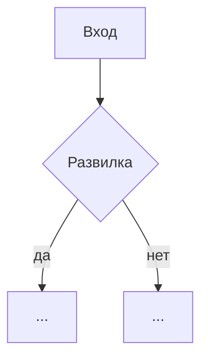

# Шаг N · <название из docs/pipeline.md>

_Обновлено: YYYY-MM-DD (задача docs/tasks/...)_

## Зачем
<1–3 предложения: какой вопрос решает шаг и что без него было бы не так>

## Вход → выход
| Вход | Выход |
|---|---|
| `data/interim/...` | `data/interim/...` |

Как запустить: `python -m rg_music.<модуль> [флаги]`

## Скрипты и главные функции
| Функция | Что делает |
|---|---|
| [module.py:NN](../../rg_music/module.py#LNN) `name()` | <одна строка> |

## Библиотеки
| Библиотека | Для чего | Почему она |
|---|---|---|
| `csv` (стандартная) | чтение и запись таблиц | <...> |

## Алгоритм простыми словами
1. <...>
2. <развилка: если ..., строка идёт в ..., иначе ...>

## Блок-схема

## Решения владелицы, которые применяет шаг
- `data/manual/...` — <что задаёт>

## Тесты
- [tests/test_....py](../../tests/test_....py) — <что проверяют>

## Ограничения и известные ошибки источника
- <...>

## Упрощение кода
<что упрощено и как доказано, что вывод не изменился; или почему упрощать нечего — конкретно>
