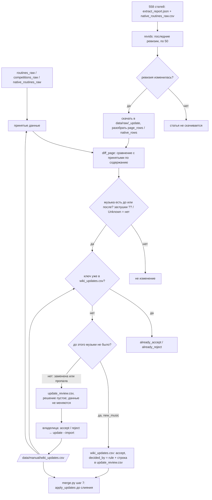

# Шаг 22 · Обновление из Википедии без тихих изменений

_Обновлено: 2026-10-20 (задача docs/tasks/2026-10-20_wiki_update.md; правило «новая музыка» уточнено владелицей)_

## Зачем
Статьи в Википедии правят: в январе появляется новый сезон, пустые строки заполняются, а иногда кто-то меняет уже
известную музыку. Шаг находит изменившиеся статьи и сравнивает их строки с принятыми данными. Музыка там, где её не было
(новая строка или заполненная заглушка, в любом году), добавляется сразу и показывается списком; замена или удаление уже
известной музыки только попадает в лист проверки: в базе оно появится лишь после решения владелицы. Раньше обновить данные можно было только через `extract --refresh`, и сырые файлы молча перезаписывались.

## Вход → выход
| Вход | Выход |
|---|---|
| `data/interim/extract_report.json` (английские статьи и их ревизии, шаг 1/6) | `data/interim/update_review.csv` — лист проверки для владелицы (Google Sheets `update_review`) |
| `data/interim/native_routines_raw.csv` (испанские и русские статьи, шаг 19) | `data/interim/update_staged.json` — все найденные изменения целиком (старая и новая строка) |
| `data/interim/routines_raw.csv`, `competitions_raw.csv`, `native_routines_raw.csv` (что уже принято) | `data/interim/update_report.json` — счёт: сколько статей изменилось, сколько строк новой музыки, сколько ждут проверки |
| Википедия: последние ревизии статей (сеть) и HTML изменившихся статей (кэш `data/raw/_update/`) | `data/manual/wiki_updates.csv` — принятые и отклонённые изменения (строки новой музыки пишутся сюда по правилу) |

Как запустить (только вручную, по команде владелицы):
1. `python -m rg_music.update` — проверка (ходит в Википедию);
2. владелица смотрит `update_review` в Google Sheets, пишет `accept` / `reject` (или `принять` / `отклонить`);
3. `python -m rg_music.update --import <лист как csv>` — решения в `data/manual/wiki_updates.csv`;
4. `python -m rg_music.pipeline --from merge`, затем `python -m rg_music.work_review --new` для новой музыки.

## Скрипты и главные функции
| Функция | Что делает |
|---|---|
| [update.py:181](../../rg_music/update.py#L181) `run_update()` | главный проход: принятые данные → ревизии → скачать изменившиеся → сравнить → разложить на «новая музыка» и «на проверку» → записать 4 файла |
| [update.py:148](../../rg_music/update.py#L148) `tracked_pages()` | список всех 558 статей, из которых взяты данные (533 английские из `extract_report.json` + 25 испанских/русских), с ревизией первой выгрузки |
| [wiki_client.py:182](../../rg_music/wiki_client.py#L182) `WikiClient.revids()` | последняя ревизия каждой статьи, по 50 названий за запрос, с учётом переименований |
| [update.py:166](../../rg_music/update.py#L166) `fetch_rows()` | скачивает статью в `data/raw/_update/` (основной кэш не трогается) и читает таблицы кодом шагов 1 и 19 |
| [extract.py:38](../../rg_music/extract.py#L38) `page_rows()` | строки таблиц выступлений и соревнований одной английской статьи (вынесено из `extract.main`, тот же код) |
| [native_extract.py:131](../../rg_music/native_extract.py#L131) `native_rows()` | строки музыкальной таблицы испанской/русской статьи |
| [update.py:122](../../rg_music/update.py#L122) `diff_page()` | сравнение строк одной статьи: что пропало, что появилось, что изменилось: `new_music` / `changed` / `removed` |
| [update.py:58](../../rg_music/update.py#L58) `has_music()` | есть ли музыка: пусто, «?», «??», «Unknown», «—», «TBA», «desconocida»… = нет (`NO_MUSIC`) |
| [update.py:110](../../rg_music/update.py#L110) `_unmatched()` | строки, которым нет пары с тем же содержанием в другом списке (одинаковые строки сопоставляются один к одному) |
| [update.py:63](../../rg_music/update.py#L63) `content_key()` | «что говорит строка»: гимнастка, язык, год, предмет, музыка, соревнование, место; без номера строки и ревизии |
| [update.py:68](../../rg_music/update.py#L68) `change_key()` | короткий ключ изменения (sha1 от вида + старой + новой строки): по нему решение узнаётся при следующих запусках |
| [update.py:79](../../rg_music/update.py#L79) `apply_updates()` | принятые изменения поверх сырых строк: убрать старую строку (по содержанию), добавить новую; не найденную старую вернуть списком |
| [update.py:264](../../rg_music/update.py#L264) `import_decisions()` | решения из листа → `wiki_updates.csv`; строка, чья музыка не совпадает с `update_staged.json`, не импортируется |
| [update.py:142](../../rg_music/update.py#L142) `_fresh_id()` | новая строка получает таблицу `u<ревизия>t<номер>`, чтобы её id не совпал со старыми |
| [merge.py:324](../../rg_music/merge.py#L324) `main()` (шаг 7) | применяет `wiki_updates.csv` к трём сырым файлам до слияния |

## Библиотеки
| Библиотека | Для чего | Почему она |
|---|---|---|
| `requests` (через `wiki_client`) | запросы к API Википедии | вежливый клиент проекта: 1 запрос/с, User-Agent с контактом, maxlag, повторы |
| `bs4` (через `tables.py`, `native_extract.py`) | разбор HTML-таблиц | тот же разбор, что при первой выгрузке, иначе одна и та же строка выглядела бы «изменённой» |
| `csv`, `json` (стандартные) | листы, решения, отчёт; строки целиком хранятся как JSON в ячейке | одна строка решения = одно изменение со всеми полями старой и новой строки |
| `hashlib` (стандартная) | `change_key` | ключ не зависит от порядка строк и номера ревизии |
| `collections.Counter`, `defaultdict` | сопоставление одинаковых строк, счёт для отчёта, строки по статьям | стандарт |
| `datetime.date` | дата решения | стандарт |
| `re` (стандартная) | заглушка из одних «?» любой длины | проще, чем перечислять «?», «??», «????»… |
| `argparse`, `logging`, `pathlib` | ключ `--import`, сообщения об ошибках скачивания, пути | стандарт проекта |

## Алгоритм простыми словами
1. **Принятые данные** = сырые файлы шагов 1/6 и 19 + уже принятые изменения из `wiki_updates.csv`. Их строки
   раскладываются по статьям.
2. **Какие статьи изменились.** Для всех 558 статей запрашивается последняя ревизия (по 50 за запрос). Изменилась =
   ревизия не та, из которой взяты сырые данные. Сырые файлы хранят ревизию первой выгрузки, поэтому однажды
   поправленная статья скачивается при каждом запуске; это не страшно — сравнение идёт по содержанию.
3. **Скачать и прочитать** изменившиеся статьи в `data/raw/_update/` тем же кодом разбора таблиц. Ошибка скачивания —
   статья пропускается и считается в `fetch_failed`.
4. **Сравнить по содержанию**, а не по номеру строки: строка, вставленная в начало таблицы, не делает остальные
   «изменёнными». Пропавшая и появившаяся строки того же предмета, того же соревнования и пересекающегося года = одна
   и та же строка, которую поправили.
5. **Развилки для каждого изменения:**
   - музыки нет ни до, ни после (пусто, «??», «Unknown», многоборье) → не изменение, пропуск;
   - ключ изменения уже есть в `wiki_updates.csv` → пропуск (`already_accept` / `already_reject`): отклонённое не
     показывается снова;
   - музыка появилась там, где её не было (новая строка или заполненная заглушка, в любом году) → `new_music`: сразу
     пишется в `wiki_updates.csv` (`decided_by = rule`) и стоит в листе с `decision = accept`, пока владелица его не
     посмотрит;
   - известная музыка заменена другой (`changed`) или пропала (`removed`, в том числе заменена заглушкой) → в лист с
     пустым решением; в данных ничего не меняется.
6. **Решения владелицы** (`--import`): `accept` / `reject`; строка листа сверяется с `update_staged.json` (музыка до и
   после должна совпасть), иначе импорт останавливается. После импорта строка помечена `reviewed = yes` и из листа уходит.
7. **Применение** — в шаге 7 (`merge.py`): принятое изменение убирает старую строку (по содержанию) и добавляет новую;
   если старой строки больше нет, ключ попадает в `unused_owner_rows`.

## Блок-схема

## Решения владелицы, которые применяет шаг
- 2026-10-20: на проверку уходит только замена (или удаление) уже известной музыки; музыка там, где её не было (новая
  строка, пустая ячейка, «??» и подобные заглушки), в любом году добавляется сразу и показывается списком (можно
  отклонить); запуск — вручную по команде.
- `data/manual/wiki_updates.csv` — принятые и отклонённые изменения (ключ `change_key`, строки целиком в JSON-колонках
  `old_row` / `new_row`). Сейчас 6 строк по правилу: Verdeș 2026 обруч, Mirano Kita 2026 четыре предмета, Ilteriakova
  2027 обруч; владелица их ещё не просматривала (`reviewed` пуст).

## Тесты
- [tests/test_update.py](../../tests/test_update.py) — 7 тестов: вставка строки в начало таблицы не делает остальные
  изменёнными; музыка вместо пустоты и заглушек («??», «Unknown») в любом году — `new_music`; замена и удаление
  известной музыки — на проверку; принятое применяется по содержанию, отклонённое нет, пропавшая старая строка возвращается списком;
  полный проход с поддельной Википедией (новая музыка по правилу, отказ владелицы не показывается снова, после принятия
  строка уходит из листа); ключ изменения не зависит от номера строки и ревизии.

## Ограничения и известные ошибки источника
- Изменение музыки в строке текущего года (гимнастка сменила музыку посреди сезона, а статью переписали) идёт на
  проверку, а не добавляется второй строкой.
- Строка за прошлый год, которой раньше не было вовсе, добавляется по правилу (это не расхождение, а новые данные);
  если она ошибочна, владелица отклоняет её в листе.
- Если статью переименуют, у всех её строк сменится `gymnast_page`: все старые строки придут как `changed` с той же
  музыкой (шумно, но не молча).
- В `update_report.json` повторного запуска нет счёта строк новой музыки, ещё не просмотренных владелицей: их список
  только в `update_review.csv`.

## Упрощение кода
Сделано 2026-10-20 в `rg_music/update.py` (+14 −15 строк): в `diff_page` два одинаковых цикла «строки без пары по
содержанию» (для пропавших и для появившихся) заменены одной функцией `_unmatched()`.
Доказательство: `python -m pytest -q` — 237 passed; проход `run_update` без сети по кэшу `data/raw/_update/` (поддельный
`revids` отдаёт ревизии из кэша) до и после изменения дал побайтно одинаковые `wiki_updates.csv`, `update_review.csv`,
`update_staged.json` (47 изменившихся статей, 6 строк новой музыки, 0 на проверку); `pipeline --from merge` — все
`data/interim/*.csv` и `site/data.json` с теми же md5, кроме порядка равных строк в `work_merge_review.csv` (см. ниже).

Не сделано (предложения):
- В `wiki_client.py` три функции (`resolve_titles`, `revids`, `langlinks`) одинаково режут названия по 50 и
  разворачивают переименования; общий помощник уменьшил бы код, но это сетевой клиент других шагов — только предложение.
- Чтение CSV с проверкой «файла нет» повторяется в `update.py` трижды, но с разной кодировкой (`utf-8-sig` для файла
  владелицы, `utf-8` для сырых): общий помощник скрыл бы это различие.
- `works.py:213` сортирует `work_merge_review.csv` только по похожести, поэтому порядок равных строк меняется от запуска
  к запуску (строки те же, что в HEAD); второй ключ сортировки (`title_a`, `title_b`) убрал бы шум в `git diff`.
