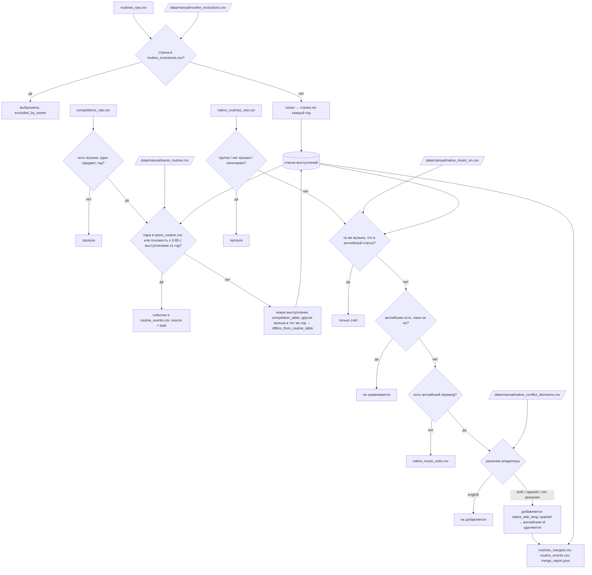

# Шаг 7 · Слияние таблиц соревнований с выступлениями, сезоны в годы

_Обновлено: 2026-10-20 (задача docs/tasks/2026-10-20_step7_guide.md). С шага 19 этот же скрипт вливает родную Википедию._

## Зачем
В статье гимнастки музыка бывает в двух таблицах: «Год / Предмет / Музыка» и таблица соревнований (Олимпиада и т. п.).
Шаг собирает их в один список выступлений «одна строка = гимнастка + год + предмет + музыка», чтобы одно и то же
выступление не считалось дважды, а соревнование стало его событием. Без шага сезон «2022/2023» был бы одним годом, а
гимнастки, у которых музыка есть только в таблице соревнований (Кабаева), остались бы без музыки.

## Вход → выход
| Вход | Выход |
|---|---|
| `data/interim/routines_raw.csv` (таблицы выступлений, шаг 1/6) | `data/interim/routines_merged.csv` — одна строка на выступление и год |
| `data/interim/competitions_raw.csv` (таблицы соревнований с музыкой) | `data/interim/routine_events.csv` — где выступление показано (много на одно) |
| `data/interim/native_routines_raw.csv` (испанская и русская Википедия, шаг 19; если файла нет — часть пропускается) | `data/interim/native_music_todo.csv` — ячейки без английского перевода (сейчас пуст) |
| `data/manual/*.csv` — решения владелицы (ниже) | `data/interim/merge_report.json` — что слито, добавлено, пропущено |

Как запустить: `python -m rg_music.merge` (или `python -m rg_music.pipeline --from merge --to merge`; дальше по цепочке — `parse`).

## Скрипты и главные функции
| Функция | Что делает |
|---|---|
| [merge.py:310](../../rg_music/merge.py#L310) `main()` | читает входы, вызывает два слияния, удаляет отвергнутые английские строки, сортирует, пишет 4 файла |
| [merge.py:144](../../rg_music/merge.py#L144) `merge_sources()` | исключения владелицы → сезоны в годы → каждую строку соревнования слить с выступлением или добавить новой |
| [merge.py:122](../../rg_music/merge.py#L122) `expand_routines()` | сезон «2022/2023» → две строки (id `...#2022`, `...#2023`), пометка `expanded_from_season` |
| [merge.py:79](../../rg_music/merge.py#L79) `music_score()` | похожесть двух ячеек музыки: весь текст или лучшая пара названий треков; название целиком внутри другого = 0.9 |
| [merge.py:74](../../rg_music/merge.py#L74) `_track_names()` | названия треков и произведений, которые парсер шага 2 видит в ячейке |
| [merge.py:235](../../rg_music/merge.py#L235) `merge_native()` | строки родной Википедии: та же музыка → только счёт; пробел → добавить; другая музыка → добавить с пометкой или по решению владелицы |
| [merge.py:219](../../rg_music/merge.py#L219) `_same_music()` | испанская строка = английской? по английскому переводу; без перевода — английское название внутри испанского текста |
| [merge.py:96](../../rg_music/merge.py#L96) `load_same_routine()`, [:105](../../rg_music/merge.py#L105) `load_exclusions()`, [:211](../../rg_music/merge.py#L211) `load_native_music()`, [:228](../../rg_music/merge.py#L228) `load_native_decisions()` | читают файлы владелицы (нет файла = нет решений) |
| [merge.py:113](../../rg_music/merge.py#L113) `_sort_key()` | порядок строк в выходе: гимнастка, год, предмет, id |
| [years.py:11](../../rg_music/years.py#L11) `parse_years()`, [:27](../../rg_music/years.py#L27) `expand_years()` | «2017-18» → (2017, 2018) → [2017, 2018]; не год → пусто |
| [crosscheck.py:42](../../rg_music/crosscheck.py#L42) `similarity()`, [:34](../../rg_music/crosscheck.py#L34) `norm_music()`, [:25](../../rg_music/crosscheck.py#L25) `FUZZY_OK = 0.85` | сравнение текстов без регистра, акцентов, кавычек; порог «та же музыка» |
| [apparatus.py:36](../../rg_music/apparatus.py#L36) `normalize_apparatus()` | «Hoop (first)» → hoop: предметы сравниваются без варианта и контекста |
| [native_extract.py:81](../../rg_music/native_extract.py#L81) `split_year()`, [:108](../../rg_music/native_extract.py#L108) `translate_apparatus()` | «1994 (Individual júnior)» → год + категория; «Aro» → Hoop, «5 cintas» → групповое |

## Библиотеки
| Библиотека | Для чего | Почему она |
|---|---|---|
| `csv` (стандартная) | чтение и запись таблиц | файлы небольшие (4 тыс. строк), pandas не нужен; `utf-8-sig` для файлов владелицы из Excel/Sheets |
| `difflib.SequenceMatcher` (стандартная, через `crosscheck.similarity`) | похожесть двух текстов музыки, 0…1 | без внешних зависимостей; на 300 строк соревнований скорость не важна (шаг идёт ~1 с) |
| `unicodedata`, `re` (стандартные, через `norm_music`) | убрать акценты, кавычки, знаки перед сравнением | «Boléro» и «Bolero» — одно и то же |
| `collections.Counter`, `json` | счётчики и отчёт `merge_report.json` | счётчик с нулём по умолчанию, отчёт читается и человеком, и `pipeline.py` |
| `argparse`, `pathlib` | ключ `--dir` (другая папка входов и выходов) и пути | стандарт проекта |

## Алгоритм простыми словами
1. **Исключения владелицы.** Строка таблицы выступлений, совпавшая с `routine_exclusions.csv` (гимнастка + год + предмет +
   музыка дословно как в сырой таблице), выбрасывается; в отчёте — `excluded_by_owner`.
2. **Сезоны в годы.** Год «2022/2023» или «2010-2012» → по строке на каждый год, тексты одинаковы, id `...#2022`,
   `year_source` хранит исходный текст. Нечитаемый год оставляется как есть с пометкой `year_unreadable` (сейчас 0).
3. **Строки соревнований**, по одной:
   - нет музыки, нет одного предмета (многоборье) или нет года → пропуск (`competition_rows_skipped`, 88);
   - кандидаты = выступления той же гимнастки, того же предмета (без варианта), с годом ±1;
   - если пара есть в `same_routine.csv` владелицы **или** лучший кандидат похож на ≥ 0.85 → это то же выступление:
     источник `both`, соревнование становится событием; год выступления не меняется, при расхождении пометка
     `event_year_differs`;
   - иначе → новое выступление `competition_table`; если в тот же год на этом предмете уже есть другая музыка —
     пометка `differs_from_routine_table` (конфликт виден, ничего не перезаписано). Новая строка сразу становится
     кандидатом для следующих строк соревнований (одна музыка на нескольких турнирах = одно выступление).
4. **Родная Википедия** (если есть `native_routines_raw.csv`), по строке:
   - групповое упражнение, нет музыки («desconocida», «????») или нечитаемые год/предмет → пропуск со счётчиком;
   - сезон раскладывается на годы; для каждого года ищутся английские выступления той же гимнастки, года и предмета;
   - та же музыка → только счёт (`native_rows_same_as_english`, 346);
   - английские есть, но язык не в `COMPARE_LANGS` (русский) → не сравнивается, не добавляется (110);
   - нет английского перевода ячейки → в `native_music_todo.csv`, не добавляется;
   - решение владелицы `english` → не добавляется; `both` → добавляется с `kept_both_by_owner`; `spanish` → добавляется,
     английские id из решения удаляются; без решения при другой музыке → добавляется с `differs_from_english_article`;
   - английских выступлений нет → добавляется (`native_wiki_es` / `native_wiki_ru`, пометка `translated_from_<lang>`,
     категория `category_junior` и т. п.). Текст музыки — английский перевод владелицы/Claude, не испанский.
5. Удалить отвергнутые английские строки, отсортировать, записать файлы и отчёт.

## Блок-схема

## Решения владелицы, которые применяет шаг
- `data/manual/routine_exclusions.csv` — выступления, которые источник указал ошибочно (Арина Аверина 2020, обруч, «Largo
  Al Factotum»). Ключ — текст сырой таблицы дословно.
- `data/manual/same_routine.csv` — разные формулировки одного выступления (Годунко 2008 скакалка Gopak/Hopak, Сон Ён Чжэ
  2012 мяч Limelight/Chaplin).
- `data/manual/native_music_en.csv` — английская формулировка каждой испанской/русской ячейки (178, проверены владелицей).
- `data/manual/native_conflict_decisions.csv` — 8 решений по расхождениям с английской статьёй (both 4, english 3,
  spanish 1).

## Тесты
- [tests/test_merge.py](../../tests/test_merge.py) — 14 тестов: сезоны в годы, слияние соревнования в событие,
  несколько событий на выступление, конфликт с пометкой, год ±1, пропуск многоборья, совпадение по названию трека,
  решения владелицы `same_routine` и исключения.
- [tests/test_native.py](../../tests/test_native.py) (со строки 51) — 7 тестов `merge_native`: заполнение пробела,
  сезон без повторов, конфликт с пометкой, непереведённые ячейки в todo, совпадение без перевода по названию, русские строки не сравниваются, три вида
  решений владелицы.

## Ограничения и известные ошибки источника
- Порог 0.85 и окно ±1 год — эвристика: соседний сезон с похожей музыкой может слиться (тогда пометка
  `event_year_differs` в `notes`).
- Год строки соревнования — первый год, если там сезон.
- Ключи файлов владелицы — дословный текст ячейки. Если статью в Википедии поправят, решение перестанет срабатывать;
  такие строки попадают в `unused_owner_rows` в `merge_report.json`, и `pipeline.py` печатает их как
  `unused owner row` (добавлено 2026-10-20 по решению владелицы).
- Русские строки не сравниваются с английскими: известный конфликт Арина Аверина 2015, лента (Paquita / Rio Rita) не
  виден в выходе; нужен отчёт проверки.
- Конфликты источников (Витриченко 2000, Жукова 2008) хранятся двумя строками с пометкой, не решаются автоматически.

## Упрощение кода
Сделано 2026-10-20 в `rg_music/merge.py` (+17 −10 строк, поведение то же):
- одинаковая сортировка была написана дважды (в `merge_sources` и `main`) → одна функция `_sort_key()`;
- одно и то же выражение «названия треков ячейки» было в `music_score` (как lambda) и в `_same_music` → `_track_names()`;
- в `main` множество `dropped_english` строилось заново для каждой строки → строится один раз;
- в счётчике решений `decision or 'added'` никогда не давал `added` (стоял внутри `if decision`) → убрано.

Доказательство: `python -m pytest -q` — 229 passed; `python -m rg_music.pipeline --from merge --to merge` до и после
изменения; `git diff --stat data/ site/` пуст в обоих случаях (кроме `pipeline_report.json`, где меняется только время
этапа; он возвращён к версии до прогона).

Не сделано (предложения):
- `_write_csv` почти одинаков в `extract.py`, `merge.py`, `parse.py`, `worlds.py`, а чтение файлов владелицы с
  проверкой «файла нет» повторяется в 10 местах проекта: общий модуль помощников затронул бы другие шаги, поэтому
  только как предложение.
- Четыре загрузчика файлов владелицы похожи, но возвращают разные структуры (множество кортежей, словарь перевода,
  словарь решений) и по-разному чистят ячейки; общий загрузчик спрятал бы эти различия.
